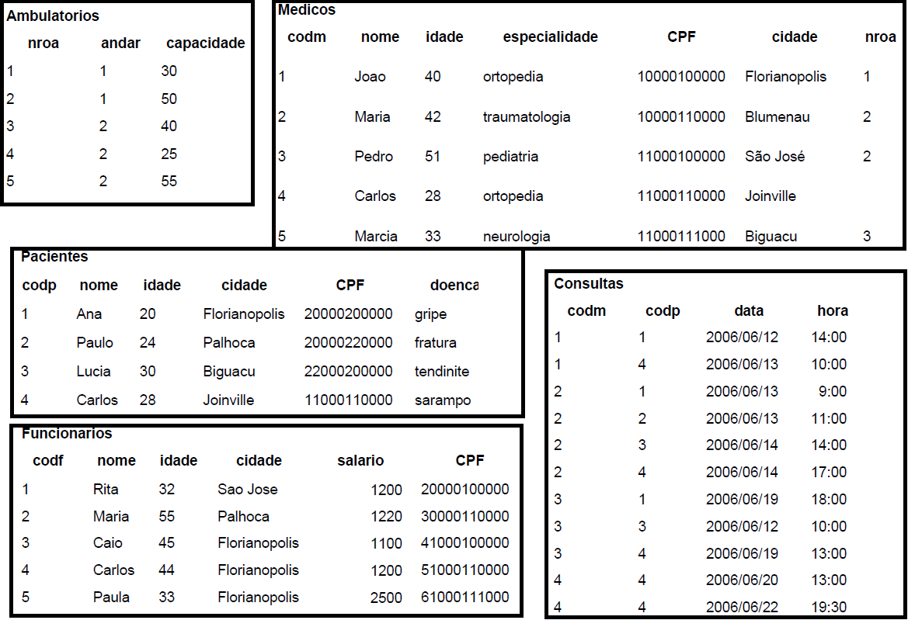

# Exercícios do Banco de Dados de uma Clínica em SQL {.unlisted -}

## DDL e DML de Alteração

### Questão 1

Crie um BD com nome 'clinica' e em seguida, apresente as expressões SQL para criar as seguintes tabelas neste BD (coloque a resposta no campo de texto desta questão):

* ambulatorios (\#nroa:serial, andar: int, \[capacidade:int])
* medicos (\#codm:serial,  nome:character varying(40), idade:int, \[especialidade:character varying(20)], cpf:numeric(11,0), \[cidade:character varying(30)], \[\&nroa:int])
* pacientes (\#codp:serial, nome:character varying(40), idade:int, \[cidade:character varying(30)], cpf:numeric(11,0), doenca:character varying(40))
* funcionarios (\#codf:serial, nome:character varying(40), idade:int, \[cidade:character varying(30)], cpf:numeric(11,0), \[salario:numeric(8,2)], \[cargo:character varying(20)])
* consultas (#\&codm:int, #\&codp:int, \#data:date, hora:time)

**Observações**:

    1. A chave primária de uma relação é definida pelo conjunto de atributos pré-fixados com #;
    2. Atributos entre colchetes \[] são opcionais;
    3. Atributos pré-fixados com & correspondem a chaves estrangeiras. Toda chave estrangeira se refere a um valor de chave primária;

#### Criação das tabelas

```sql
SET statement_timeout = 0;
SET lock_timeout = 0;
SET idle_in_transaction_session_timeout = 0;
SET client_encoding = 'UTF8';
SET standard_conforming_strings = on;
SELECT pg_catalog.set_config('search_path', '', false);
SET check_function_bodies = false;
SET xmloption = content;
SET client_min_messages = warning;
SET row_security = off;

SET default_tablespace = '';

--
--

CREATE TABLE public.ambulatorios (
    nroa integer NOT NULL,
    capacidade smallint,
    andar numeric(3,0) NOT NULL
);

ALTER TABLE public.ambulatorios OWNER TO postgres;


CREATE TABLE public.consultas (
    codm integer NOT NULL,
    codp integer,
    data date NOT NULL,
    hora time without time zone NOT NULL
);

ALTER TABLE public.consultas OWNER TO postgres;


CREATE TABLE public.funcionarios (
    codf integer NOT NULL,
    nome character varying(40) NOT NULL,
    idade smallint,
    cpf numeric(11,0),
    cidade character varying(30),
    salario numeric(10,0)
);

ALTER TABLE public.funcionarios OWNER TO postgres;


CREATE TABLE public.medicos (
    codm integer NOT NULL,
    nome character varying(40) NOT NULL,
    idade smallint NOT NULL,
    especialidade character(20),
    cpf numeric(11,0),
    cidade character varying(30),
    nroa integer
);

ALTER TABLE public.medicos OWNER TO postgres;


CREATE TABLE public.pacientes (
    codp integer NOT NULL,
    nome character varying(40) NOT NULL,
    idade smallint NOT NULL,
    cidade character(30),
    cpf numeric(11,0),
    doenca character varying(40) NOT NULL
);

ALTER TABLE public.pacientes OWNER TO postgres;
```

#### Alimentação de dados

```sql
INSERT INTO public.ambulatorios (nroa, capacidade, andar) VALUES (1, 30, 1);
INSERT INTO public.ambulatorios (nroa, capacidade, andar) VALUES (2, 50, 1);
INSERT INTO public.ambulatorios (nroa, capacidade, andar) VALUES (3, 40, 2);
INSERT INTO public.ambulatorios (nroa, capacidade, andar) VALUES (4, 25, 2);
INSERT INTO public.ambulatorios (nroa, capacidade, andar) VALUES (5, 55, 2);

INSERT INTO public.consultas (codm, codp, data, hora) VALUES (1, 1, '2006-06-12', '14:00:00');
INSERT INTO public.consultas (codm, codp, data, hora) VALUES (1, 4, '2006-06-13', '10:00:00');
INSERT INTO public.consultas (codm, codp, data, hora) VALUES (2, 1, '2006-06-13', '09:00:00');
INSERT INTO public.consultas (codm, codp, data, hora) VALUES (2, 2, '2006-06-13', '11:00:00');
INSERT INTO public.consultas (codm, codp, data, hora) VALUES (2, 3, '2006-06-14', '14:00:00');
INSERT INTO public.consultas (codm, codp, data, hora) VALUES (2, 4, '2006-06-14', '17:00:00');
INSERT INTO public.consultas (codm, codp, data, hora) VALUES (3, 1, '2006-06-19', '18:00:00');
INSERT INTO public.consultas (codm, codp, data, hora) VALUES (3, 3, '2006-06-12', '10:00:00');
INSERT INTO public.consultas (codm, codp, data, hora) VALUES (3, 4, '2006-06-19', '13:00:00');
INSERT INTO public.consultas (codm, codp, data, hora) VALUES (4, 4, '2006-06-20', '13:00:00');
INSERT INTO public.consultas (codm, codp, data, hora) VALUES (4, 4, '2006-06-22', '19:30:00');

INSERT INTO public.funcionarios (codf, nome, idade, cpf, cidade, salario) VALUES (1, 'Rita', 32, 20000100000, 'Sao Jose', 1200);
INSERT INTO public.funcionarios (codf, nome, idade, cpf, cidade, salario) VALUES (2, 'Maria', 55, 30000110000, 'Palhoca', 1220);
INSERT INTO public.funcionarios (codf, nome, idade, cpf, cidade, salario) VALUES (3, 'Caio', 45, 41000100000, 'Florianopolis', 1100);
INSERT INTO public.funcionarios (codf, nome, idade, cpf, cidade, salario) VALUES (4, 'Carlos', 44, 51000110000, 'Florianopolis', 1200);
INSERT INTO public.funcionarios (codf, nome, idade, cpf, cidade, salario) VALUES (5, 'Paula', 33, 61000111000, 'Florianopolis', 2500);

INSERT INTO public.medicos (codm, nome, idade, especialidade, cpf, cidade, nroa) VALUES (1, 'Joao', 40, 'ortopedia           ', 10000100000, 'Florianopolis', 1);
INSERT INTO public.medicos (codm, nome, idade, especialidade, cpf, cidade, nroa) VALUES (2, 'Maria', 42, 'traumatologia       ', 10000110000, 'Blumenau', 2);
INSERT INTO public.medicos (codm, nome, idade, especialidade, cpf, cidade, nroa) VALUES (4, 'Carlos', 28, 'ortopedia           ', 11000110000, 'Joinville', NULL);
INSERT INTO public.medicos (codm, nome, idade, especialidade, cpf, cidade, nroa) VALUES (3, 'Pedro', 51, 'pediatria           ', 11000100000, 'Sao Jose', 2);
INSERT INTO public.medicos (codm, nome, idade, especialidade, cpf, cidade, nroa) VALUES (5, 'Marcia', 33, 'neurologia          ', 11000111000, 'Biguacu', 3);

INSERT INTO public.pacientes (codp, nome, idade, cidade, cpf, doenca) VALUES (1, 'Ana', 20, 'Florianopolis                 ', 20000200000, 'gripe');
INSERT INTO public.pacientes (codp, nome, idade, cidade, cpf, doenca) VALUES (2, 'Paulo', 24, 'Palhoca                       ', 20000220000, 'fratura');
INSERT INTO public.pacientes (codp, nome, idade, cidade, cpf, doenca) VALUES (3, 'Lucia', 30, 'Biguacu                       ', 22000200000, 'tendinite');
INSERT INTO public.pacientes (codp, nome, idade, cidade, cpf, doenca) VALUES (4, 'Carlos', 28, 'Joinville                     ', 11000110000, 'sarampo');
```

#### Criação das chaves secundárias

```sql
ALTER TABLE ONLY public.ambulatorios
    ADD CONSTRAINT ambulatorios_pkey PRIMARY KEY (nroa);


ALTER TABLE ONLY public.consultas
    ADD CONSTRAINT consultas_pkey PRIMARY KEY (codm, data, hora);


ALTER TABLE ONLY public.funcionarios
    ADD CONSTRAINT funcionarios_cpf_key UNIQUE (cpf);

ALTER TABLE ONLY public.funcionarios
    ADD CONSTRAINT funcionarios_pkey PRIMARY KEY (codf);


ALTER TABLE ONLY public.medicos
    ADD CONSTRAINT medicos_cpf_key UNIQUE (cpf);

ALTER TABLE ONLY public.medicos
    ADD CONSTRAINT medicos_pkey PRIMARY KEY (codm);


ALTER TABLE ONLY public.pacientes
    ADD CONSTRAINT pacientes_cpf_key UNIQUE (cpf);

ALTER TABLE ONLY public.pacientes
    ADD CONSTRAINT pacientes_pkey PRIMARY KEY (codp);

CREATE UNIQUE INDEX indice_cpf ON public.medicos USING btree (cpf);


ALTER TABLE ONLY public.consultas
    ADD CONSTRAINT consultas_codm_fkey FOREIGN KEY (codm) REFERENCES public.medicos(codm);

ALTER TABLE ONLY public.consultas
    ADD CONSTRAINT consultas_codp_fkey FOREIGN KEY (codp) REFERENCES public.pacientes(codp);


ALTER TABLE ONLY public.medicos
    ADD CONSTRAINT medicos_nroa_fkey FOREIGN KEY (nroa) REFERENCES public.ambulatorios(nroa);
```

2. Faça uma expressão em SQL que crie uma coluna com nome 'nroa' e tipo 'int' na tabela Funcionários. Use o comando Alter table.

```sql
questao
```

3. Formule expressões SQL para criar os seguintes índices:

\- índice único sobre o campo cpf de medicos
\- índice sobre o campo doenca de pacientes

```sql
questao
```

4. Formule uma expressão em SQL para remover o índice doenca de pacientes.

```sql
questao
```

5. Formule uma expressão SQL que remova as colunas cargo e nroa de funcionarios.

```sql
questao
```

6. Crie expressões SQL que insiram dados nas tabelas conforme a figura a seguir:



```sql
questao
```

